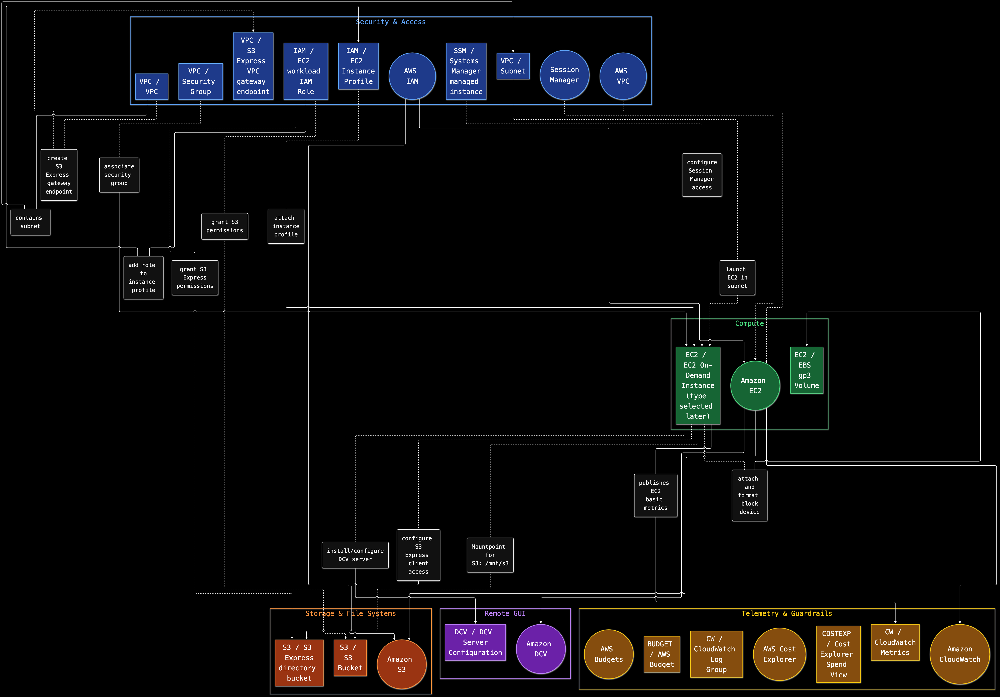
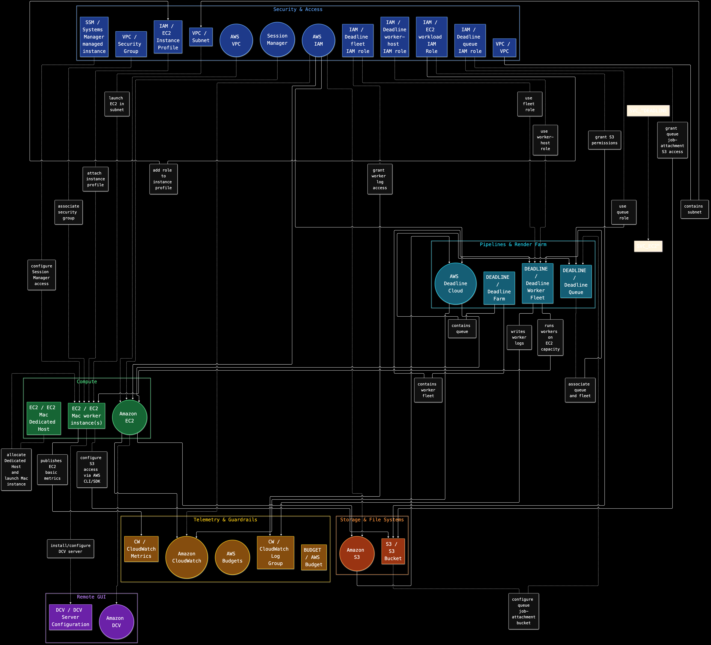
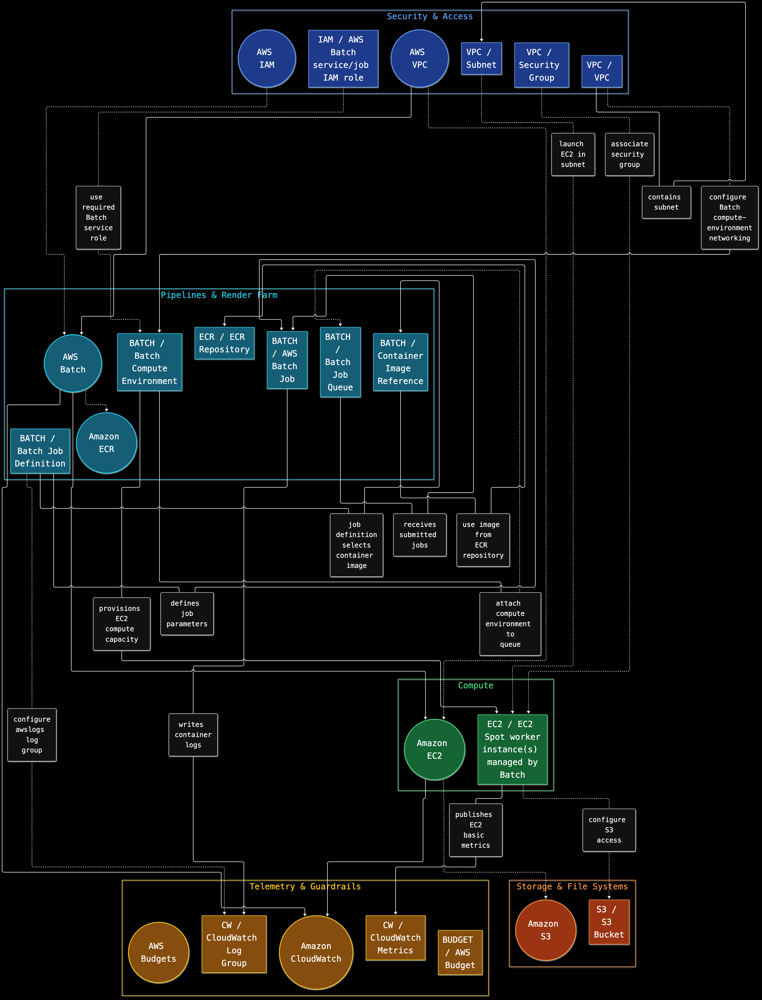
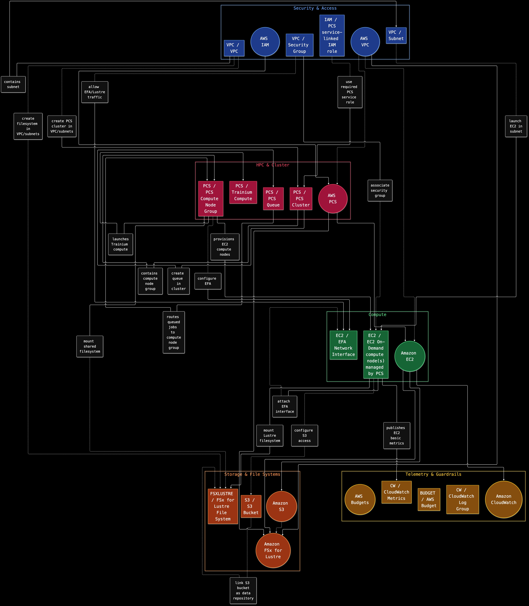
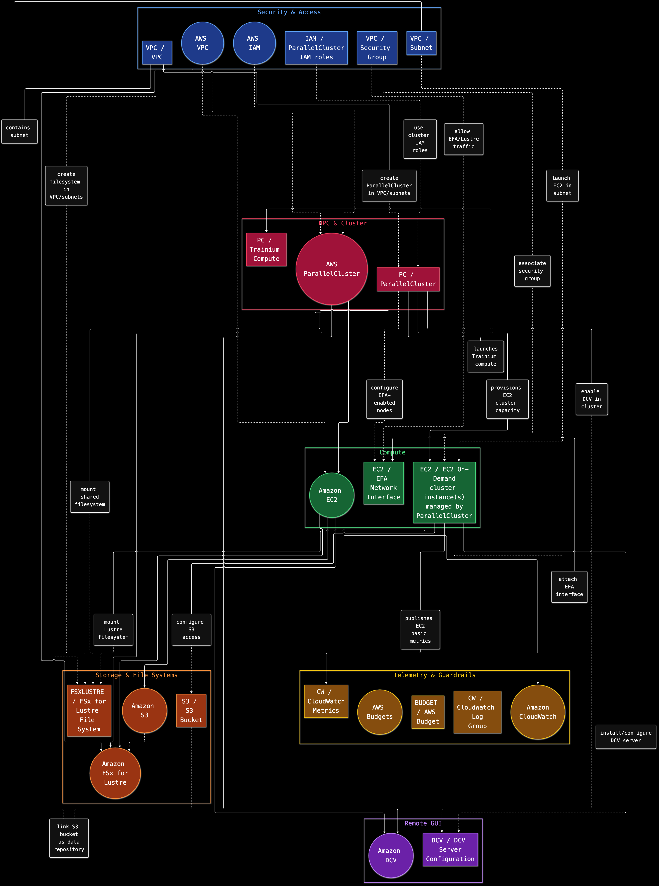
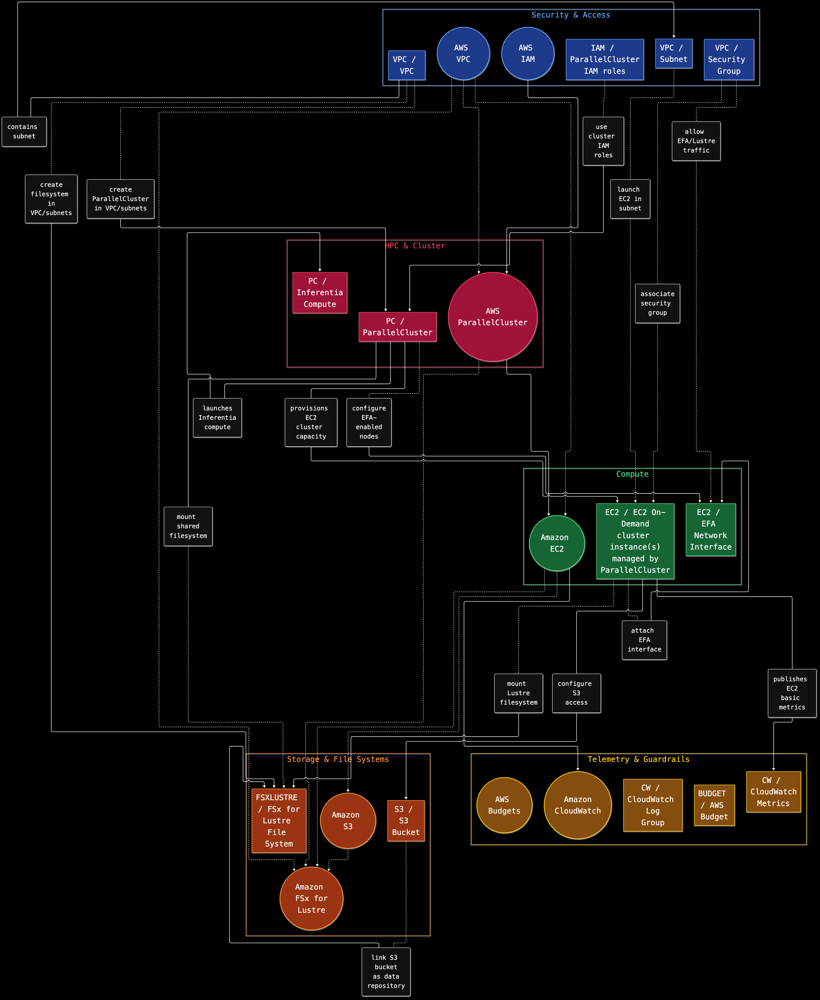
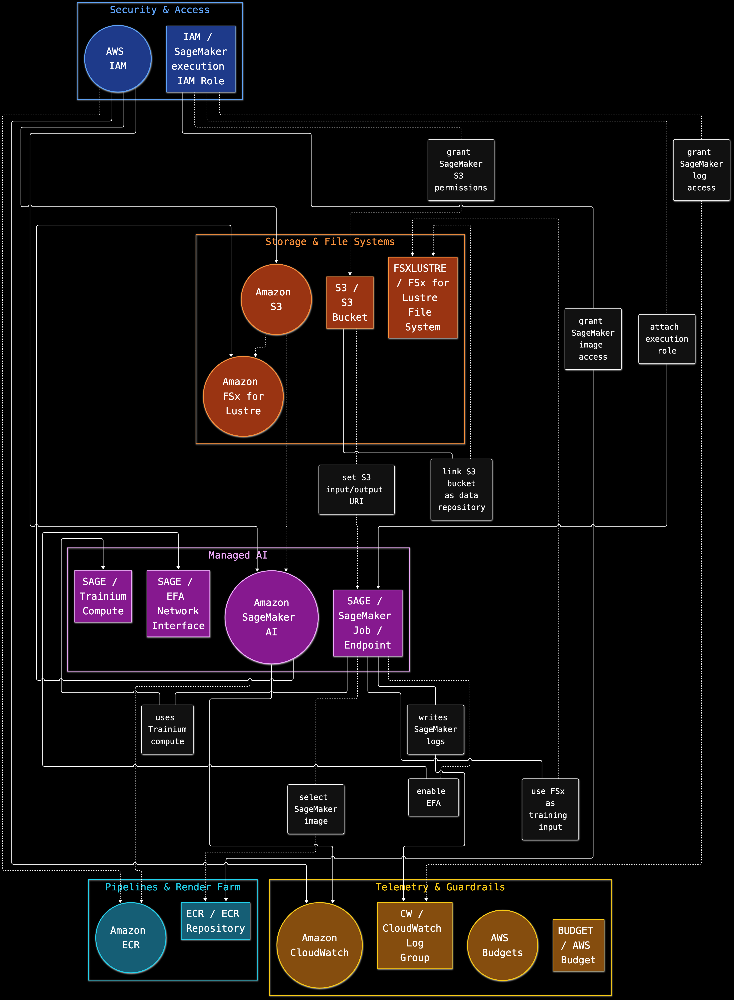
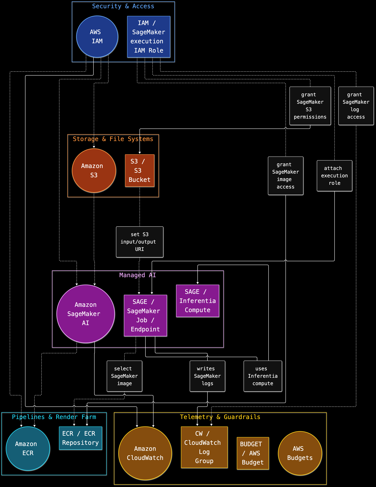
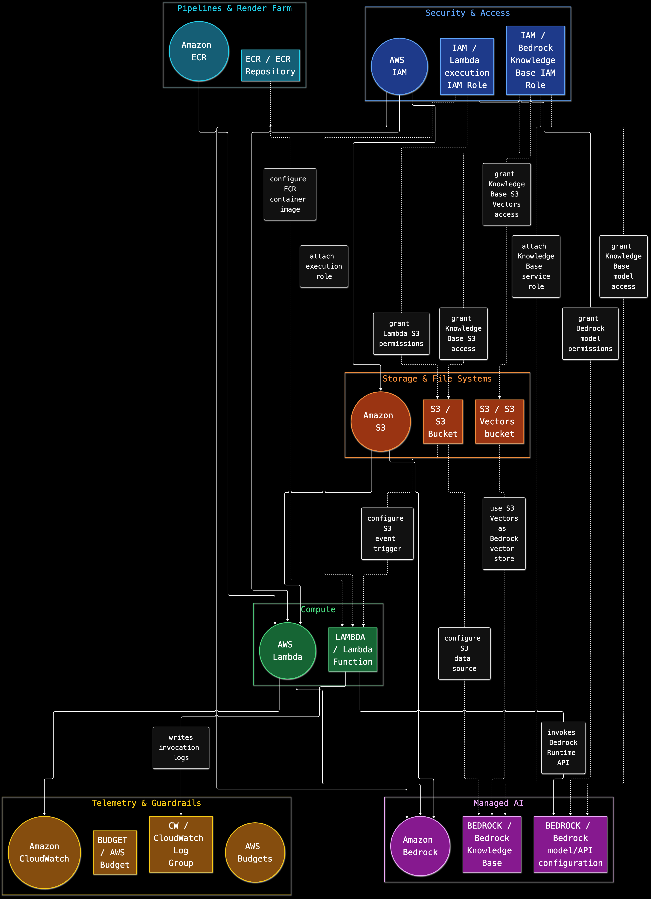

# AWS ASCII Planner

Plan AWS compute architectures from a short interactive interview. The planner recommends services, concrete resources, and the relationships between them, then writes a native ASCII architecture graph, a graph audit, and a versioned JSON plan. It does not create AWS resources.

Maintained by [fvitorino00](https://github.com/fvitorino00).

## Install

Requirements:

- `zsh`
- `jq`
- `uuidgen` (`uuid-runtime` on Debian/Ubuntu)
- AWS CLI is optional; when present, it is used as a Region fallback only when no Region is configured through the environment or config files

No AWS credentials, Node.js, npm, Mermaid CLI, or `chafa` are required.

On Debian/Ubuntu, install the required tools with:

```sh
sudo apt-get update
sudo apt-get install -y zsh jq uuid-runtime
```

Other platforms need equivalent `zsh`, `jq`, and `uuidgen` tools.

Clone the repository:

```sh
git clone https://github.com/fvitorino00/aws-ascii-planner.git
cd aws-ascii-planner
```

## Use

Run the planner and answer the questions:

```sh
AWS_SETUP_REGION=us-east-1 bin/aws-plan/aws-plan
```

You can also set `AWS_SETUP_REGION` in `config/local.env`:

```sh
cp config/local.env.example config/local.env
# set AWS_SETUP_REGION in config/local.env
```

The planner does not need AWS credentials. It only asks for a Region so the written plan records where the architecture is intended to run.

The interview covers workload shape, compute, memory, interaction, storage, interruption tolerance, and orchestration. Press `e` at a yes/no question for examples that explain when to choose either answer.

## Output

The planner saves these files under `out/` (or `AWS_SETUP_OUT`):

- `architecture.txt` — ASCII architecture graph with a text legend
- `graph-audit.md` — selected resources, ownership, concrete relationships, and derived service-level relationships
- `plan.json` — versioned plan with workload requirements, selected services, resources, relationships, rationale, and target Region
- `plans/<plan-id>.json` — an archived copy of each generated plan

The planner produces recommendations only. It does not deploy infrastructure or modify your AWS account.

### ASCII graph legend

```text
A --[relationship]--> B  intrinsic architecture relationship
A ..[relationship]..> B  explicit setup/configuration action
```

The graph lists architecture relationships first, then setup actions. Concrete resource edges are taken directly from the internal resource relationship table; derived service-level relationships are recorded in the graph audit and plan JSON.

## Example workflows

The PNG images below are static curated reference examples. They illustrate the kinds of services, resources, and relationship types the planner can recommend, but they are not runtime outputs of this ASCII-first release.

### Interactive GPU workstation

You downloaded a Linux 3D visualization application, but your laptop cannot handle its scenes and you need to work in its GUI. A GPU instance supplies compute and DCV supplies the remote display. EBS holds the working set, while S3 keeps inputs and results independent of the instance. S3 Express appears only when measurements show an object-access latency bottleneck; Cost Explorer supports reviewing spend afterward.



### macOS render farm

Your rendering plug-in only runs on macOS and you have enough independent frames to need a farm. Deadline Cloud schedules work on customer-managed macOS workers running on EC2 Mac hosts. DCV supports previews and debugging, while S3 stores project files and job attachments. EC2 Mac capacity uses a Dedicated Host. [Deadline Cloud customer-managed fleets](https://docs.aws.amazon.com/deadline-cloud/latest/userguide/manage-cmf.html) and [Amazon DCV on EC2 Mac](https://docs.aws.amazon.com/dcv/latest/adminguide/setting-up-installing-macos-prerequisites.html) describe those requirements.



### Containerized parameter sweep

You need to run thousands of independent simulation inputs, and each run can restart from durable state. ECR stores the container image; AWS Batch queues jobs and scales EC2 workers with Spot capacity. S3 holds inputs and outputs, and CloudWatch receives job logs. A Batch job references a queue and job definition when submitted. [AWS Batch components](https://docs.aws.amazon.com/batch/latest/userguide/batch_components.html)



### Distributed Trainium training with AWS PCS

Your training workload needs Slurm, tightly coupled node communication, and a shared high-throughput filesystem. AWS PCS manages the Slurm control plane; EFA supports node communication, FSx for Lustre provides shared data, and Trainium supplies compute. The queue routes jobs to its associated compute node group. [AWS PCS queues](https://docs.aws.amazon.com/pcs/latest/userguide/getting-started_create-queue.html)



### Inferentia batch inference with AWS PCS

You run a large, restartable inference workload across compatible Inferentia nodes and want AWS-managed Slurm. PCS provides the cluster and queue, while EFA and FSx support communication and shared data. The compute node group selects Inferentia capacity; verify the instance family, Neuron image, quotas, and Region for the application.


### Trainium training with ParallelCluster

Your team wants distributed Trainium training but prefers to manage its Slurm cluster lifecycle with ParallelCluster. EFA and FSx for Lustre support the tightly coupled job, and DCV provides a graphical access path for interactive work. ParallelCluster provisions the EC2 capacity.



### Inferentia batch inference with ParallelCluster

You already operate a Slurm workflow for batch inference and want to add compatible Inferentia instances. ParallelCluster manages the cluster lifecycle; EFA and FSx support communication and shared data. Neuron software and the custom AMI are part of the cluster configuration.



### Managed Trainium training with SageMaker AI

You want SageMaker AI to run distributed Trainium training rather than manage the cluster lifecycle yourself. S3 holds durable artifacts, ECR stores the training image, and FSx for Lustre provides shared high-throughput data. EFA supports communication between compatible instances, and CloudWatch receives job logs. [AWS Trainium training tutorial](https://docs.aws.amazon.com/sagemaker/latest/dg/sagemaker-hyperpod-trainium-sagemaker-training-jobs-pretrain-tutorial.html)



### Inferentia-backed SageMaker endpoint

Your model is ready for inference and its Neuron stack supports an Inferentia-backed endpoint. SageMaker hosts the endpoint, S3 stores model artifacts, and ECR provides the custom inference image. An execution role grants the service access to those resources and CloudWatch logs. Confirm model, framework, instance type, and Region compatibility.



### Event-driven document assistant with Bedrock Knowledge Bases

Your team is building a document assistant. An S3 upload triggers a Lambda function packaged in ECR; the function handles application logic and invokes the Bedrock Runtime API. Separately, a Bedrock Knowledge Base uses S3 documents as its source and S3 Vectors as its vector store. [Bedrock Knowledge Bases with S3 Vectors](https://docs.aws.amazon.com/AmazonS3/latest/userguide/s3-vectors-bedrock-kb.html)



These plans are architecture recommendations. Check regional availability, quotas, instance support, operating-system images, Neuron compatibility, and networking requirements before implementing a workflow.

## Development

Run the planner interviews in an isolated temporary directory:

```sh
zsh tests/check.zsh
```

Validate a generated plan:

```sh
zsh bin/aws-plan/aws-plan-plan-validate.zsh validate --plan out/plan.json
```

## License

MIT License. See [LICENSE](LICENSE).
